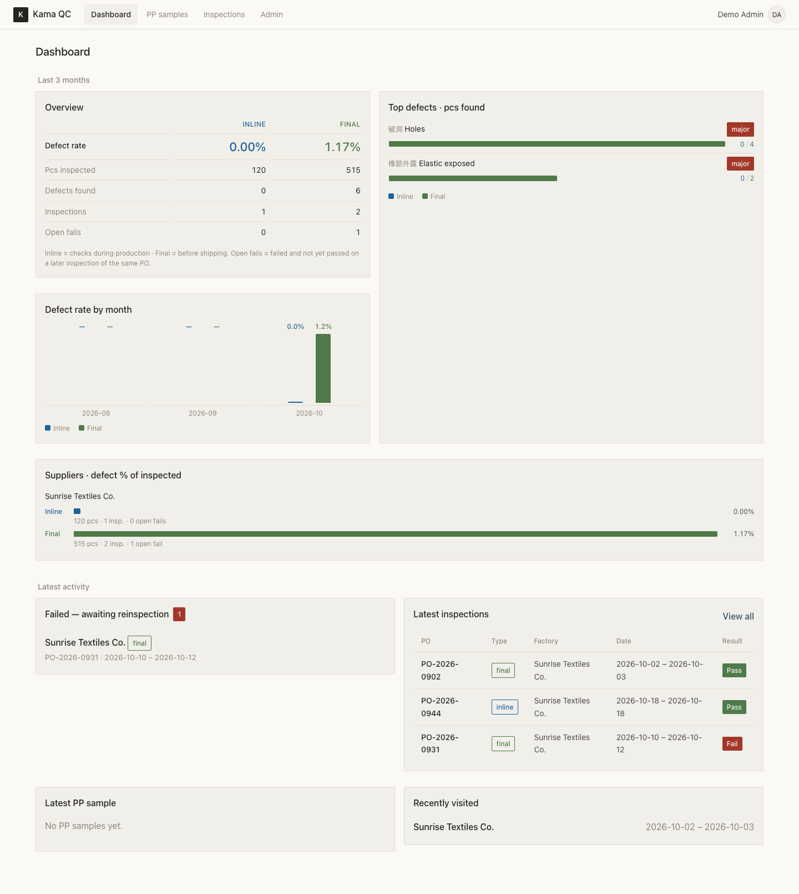
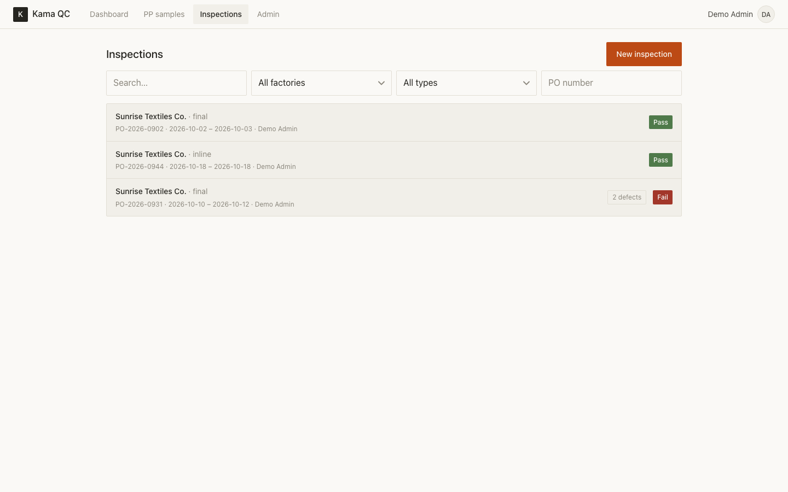
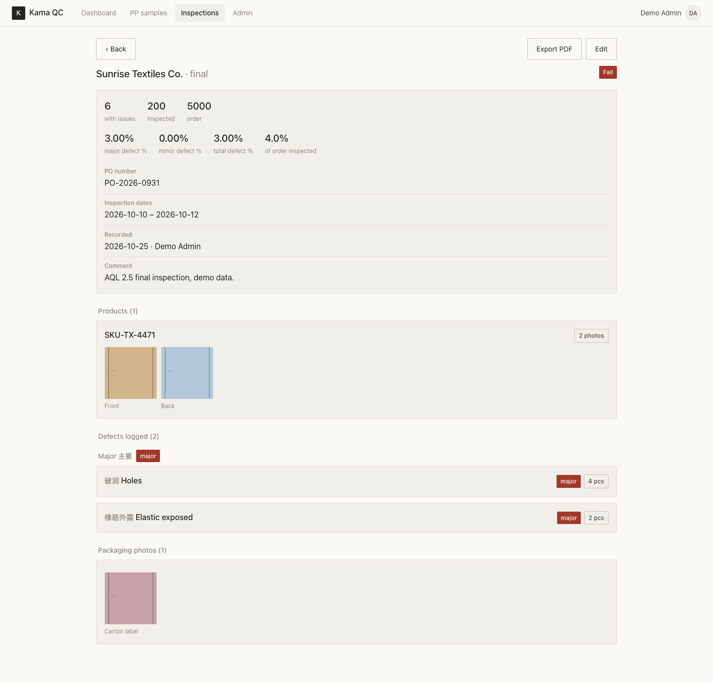

# Kama QC v3

Mobile-first QC inspection app for apparel factories. React PWA + Node/Express + PostgreSQL,
all in Docker, served behind Nginx Proxy Manager at `app.your-domain.example`.

- **PP samples** and **factory inspections** with photos and a bilingual (EN/中文) defect catalogue.
- Installable PWA with **offline-resilient autosave** (drafts survive tab-discard / dropped connection).
- All users see all entries; you edit/delete your own; admins edit/delete anything and manage
  users, suppliers and the defect catalogue.

## Screenshots

> Generated placeholder data — no real supplier, product, or customer information.

**Dashboard** — defect rate trends, top defects, supplier breakdown, latest activity



**Inspection list** — filterable by factory, type, and PO number



**Inspection detail** — product photos, packaging photos, logged defects, PDF export



## Features

- Inline and final inspections with pass/fail results, AQL-style major/minor defect tracking
- Pre-production (PP) sample approvals
- Per-product reference photos (front/back), packaging photos, measurement chart photos
- PDF export for inspections and PP samples, with bundled CJK font support
- Dashboard: defect-rate trends, top defects, supplier comparison, open-fail tracking
- PO matching helper, data exports

---

## ⚠️ Data safety (read first)

The single most important rule: **upgrades must never destroy data.**

- Postgres data lives in the named volume **`qc_pgdata`**; uploaded photos in **`qc_uploads`**.
  These are independent of the container lifecycle.
- **Never run `docker compose down -v`** — the `-v` deletes the volumes. Use `docker compose down` only.
- Schema changes are **forward-only, additive migrations** (`backend/src/db/migrations/`) applied
  automatically on backend startup. They never drop or truncate on deploy.
- Seeds are **idempotent** (`INSERT ... ON CONFLICT DO NOTHING`). Re-running on every boot never
  overwrites a user, resets a password, or duplicates rows.
- Secrets live in **`.env`** (git-ignored). See `.env.example`.

---

## Quick start (first deploy)

```bash
# 1. external network used by Nginx Proxy Manager (already created if you see it in `docker network ls`)
docker network create web   # ignore "already exists"

# 2. configure secrets
cp .env.example .env
#   set DB_PASSWORD, JWT_SECRET, ADMIN_EMAIL, ADMIN_PASSWORD (and optional NEXTCLOUD_*)
#   generate strong values, e.g.:  openssl rand -hex 32

# 3. start (pulls the published image — see "Image & deploys" below)
docker compose up -d

# 4. watch it migrate + seed
docker compose logs -f app
```

The backend runs migrations and idempotent seeds on boot, then listens on port `3000`
(not published to the host — Nginx Proxy Manager reaches it over the `web` network).

### Initial admin

On first boot an admin user is seeded **only if it does not already exist**, from:

- `ADMIN_EMAIL` (default `admin@example.com`)
- `ADMIN_PASSWORD` (set in `.env` — the install generated one for you)

Log in, then change it under **User → Change password**. The seed never resets an
existing user's password, so changing `ADMIN_PASSWORD` later has no effect once the user exists.

---

## Image & deploys

The published image is `ghcr.io/benson4ever/kama-qc-app:latest`, built and pushed automatically
by GitHub Actions on every push to `master`. The server no longer builds from source — it pulls:

```bash
git pull
docker compose pull app
docker compose up -d app
```

Migrations apply additively on boot; **data volumes are untouched.**

---

## Backups (mandatory)

`backup/backup.sh` dumps the database (`pg_dump`) **and** archives the `qc_uploads` volume,
timestamped, then pushes both **off this server** via WebDAV (Nextcloud). If no remote target is
configured it logs a loud warning that backups are local-only.

Configure the remote target in `.env`:

```
BACKUP_WEBDAV_URL=https://your-nextcloud.example.com
BACKUP_WEBDAV_USER=backup-user
BACKUP_WEBDAV_PASSWORD=app-password
```

(It falls back to `NEXTCLOUD_*` if those are set.)

### Nightly cron (host)

```bash
( crontab -l 2>/dev/null; echo "30 2 * * * ~/kama-qc/backup/backup.sh >> ~/kama-qc/backup/backup.log 2>&1" ) | crontab -
```

Local copies are rotated, keeping ~14 days (`RETENTION_DAYS`).

### Restore

```bash
# database (app can stay up; or stop it first to avoid writes)
gunzip -c backup/db_YYYYMMDD_HHMMSS.sql.gz | docker exec -i qc_postgres psql -U "$DB_USER" -d "$DB_NAME"

# photos (restores into the qc_uploads volume)
docker run --rm -v kama-qc_qc_uploads:/data -v "$PWD/backup:/backup" alpine \
  sh -c "cd /data && tar xzf /backup/uploads_YYYYMMDD_HHMMSS.tar.gz"
```

---

## Deployment, network & proxy

### DNS
Point an `A` record for `app.your-domain.example` at the VPS IP `YOUR_SERVER_IP`.

### Nginx Proxy Manager (separate stack on the `web` network, ports 80/443/81)
1. Open `http://YOUR_SERVER_IP:81`, log in, **change the default admin credentials immediately**.
2. Add a Proxy Host: domain `app.your-domain.example`, forward to host **`qc_app`** port **`3000`**
   (scheme http). Enable **Websockets Support** and **Block Common Exploits**.
3. SSL tab: request a Let's Encrypt cert, enable **Force SSL** and **HTTP/2**.

### Firewall
```bash
sudo ufw allow 80
sudo ufw allow 443
sudo ufw allow 81     # NPM admin UI — consider restricting to your IP later
```

---

## Project layout

```
backend/   Express API (/api), serves the built SPA, migrations + idempotent seeds
frontend/  React + Vite PWA (mobile-first), IndexedDB draft autosave
backup/    backup.sh (pg_dump + uploads archive, off-server push)
docs/      screenshots used in this README
.github/   Actions workflow: build + publish the Docker image to GHCR
docker-compose.yml   postgres (qc_pgdata) + app (qc_uploads), app joins the `web` network
```

### Optional Nextcloud photo sync
If `NEXTCLOUD_URL` / `NEXTCLOUD_USER` / `NEXTCLOUD_PASSWORD` are set, each uploaded photo is also
mirrored via WebDAV into `QC-Reports/YYYY-MM/{Factory}/`. Blank = disabled (default); the app works
fully on local storage alone.
